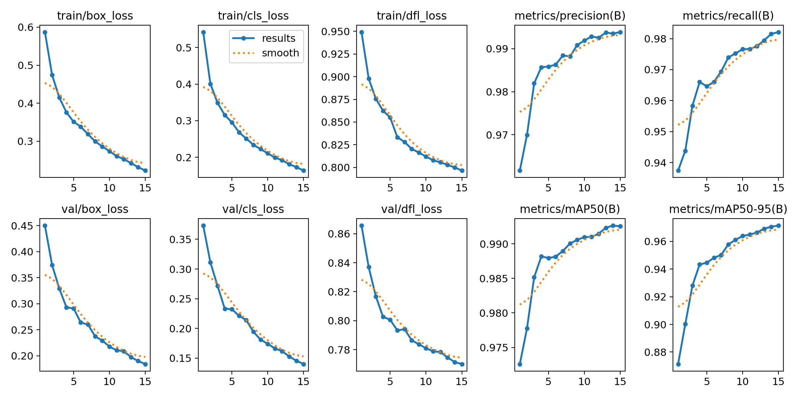

# Real-time Pose Estimation with YOLOv8

Detecting people and estimating their body pose (17 keypoints, such as shoulders, elbows and knees) **live from a webcam**. Knowing where people are and how they're moving is a basic building block for robots and assistive systems that share space with humans.

## What's inside
- **`realtime_pose.py`:** webcam pose estimation with YOLOv8n-pose, the nano model, which is small enough to run in real time on a laptop.
- **`notebooks/person_detection_training.ipynb`:** fine-tuning YOLOv8-L to detect **people and heads** on a Roboflow dataset of 2,808 validation images.

## Results
The fine-tuned detector after 15 epochs:

| Class | Precision | Recall | mAP50 | mAP50-95 |
|---|---|---|---|---|
| person | 0.994 | 0.994 | 0.995 | 0.991 |
| head | 0.994 | 0.970 | 0.990 | 0.952 |
| **all** | **0.994** | **0.982** | **0.993** | **0.971** |

Inference takes about 17 ms per image on a Tesla T4.



**What I learned:** fine-tuning the pose model on the full COCO-pose dataset didn't fit within Colab's GPU limits, as training stopped after 4 epochs. Freezing more layers and using the pretrained nano model was what made real-time pose estimation practical.

## Run it
```bash
pip install -r requirements.txt
python realtime_pose.py
```
To retrain the detector, open the notebook in Google Colab and set `ROBOFLOW_API_KEY`.

## Credits
Course project on computational intelligence at Amirkabir University of Technology (winter 2024), supervised by Dr. Abdollahi.

**Team:** Abtin Hassannejad, Sana Ranjbar, Amirhossein Gheysari and Sheyda Niaparast.

Dataset: [Roboflow "human-persons"](https://universe.roboflow.com/saad-salman-xwffp/human-persons-kqfbt).

**Tools:** Python · PyTorch · Ultralytics YOLOv8 · OpenCV · Roboflow
